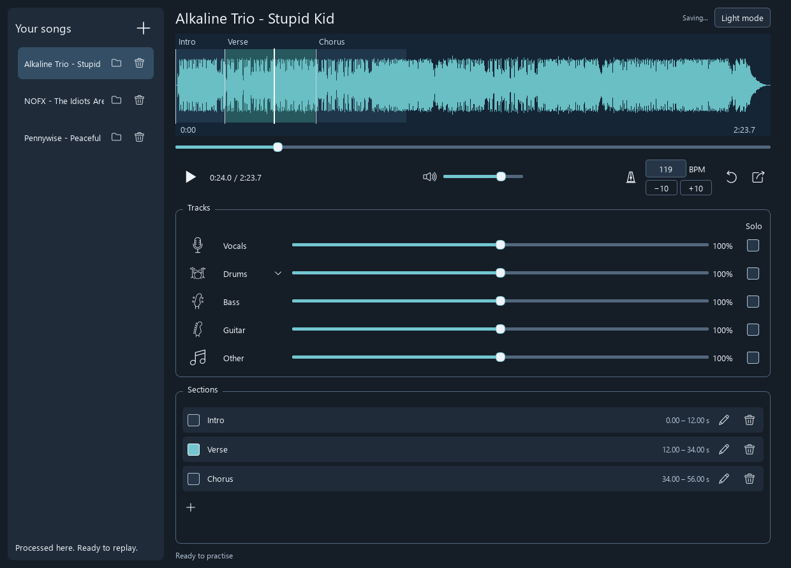
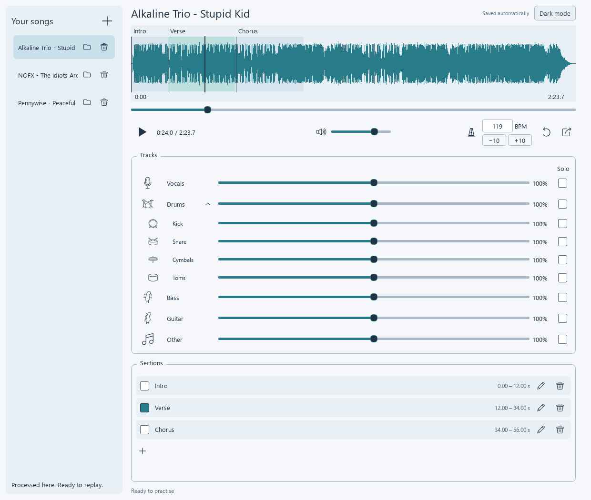

# Track Splitter

A desktop app for separating instrument tracks, mixing them, looping sections and changing playback tempo. Audio processing runs locally.

## Setup on Windows

Requires **64-bit Python 3.12**. [Download Python 3.12](https://www.python.org/downloads/release/python-31210/).

1. [Download the project ZIP](https://github.com/Dbuns/track-splitter/archive/refs/heads/main.zip) and extract it to the folder where you want to keep it.
2. Run `Setup_Track_Splitter.bat` to install the required packages.
3. Run `Start_Track_Splitter.bat` to open the app. You can create a Windows shortcut to this file.

Setup is needed once. Models download the first time you separate a song or split drums. After downloading the models, processing works offline.

Tested on Windows x64. macOS and Linux have not been tested. Separation uses the CPU.

  

## Features

- Separates vocals, drums, bass, guitar and other.
- Splits drums into kick, snare, cymbals and toms.
- Per-track volume, mute and solo, with a mix reset.
- Named sections that can be selected for looping.
- Editable BPM and pitch-preserving tempo changes, with -10/+10 BPM buttons.
- Saves the song library, mix, sections and tempo automatically.
- Exports the current mix as a WAV beside the song's stems.
- Dark and light themes.

Expanded drum tracks in light mode

  

## Using it

1. Click **+** in Your songs, or drag an audio file into the window.
2. Wait for separation. The song stays in your library for later use.
3. Click an instrument icon to mute it, or select its Solo checkbox.
4. Add a section, adjust its times or waveform handles, name it and confirm. Select sections to loop them.
5. Edit the BPM to change tempo. Click the metronome to return to the original BPM.
6. Use the export icon to save your mix.

The source setup stores the library, separated tracks, settings and model cache in the project folder. Original audio files are preserved.

## Credits and licence

I developed Track Splitter with substantial assistance from ChatGPT by OpenAI, including application code, interface design, documentation and artwork. I defined the requirements, tested the application and refined it through practical use and feedback.

The application code and artwork are [MIT licensed](LICENSE).

Separation uses [Demucs](https://github.com/facebookresearch/demucs) and [drumsep](https://github.com/inagoy/drumsep). The interface uses PySide6/Qt, with audio processing through PyTorch, SoundFile, sounddevice and FFmpeg.

See [third-party notices](docs/THIRD_PARTY.md) for their licences.
